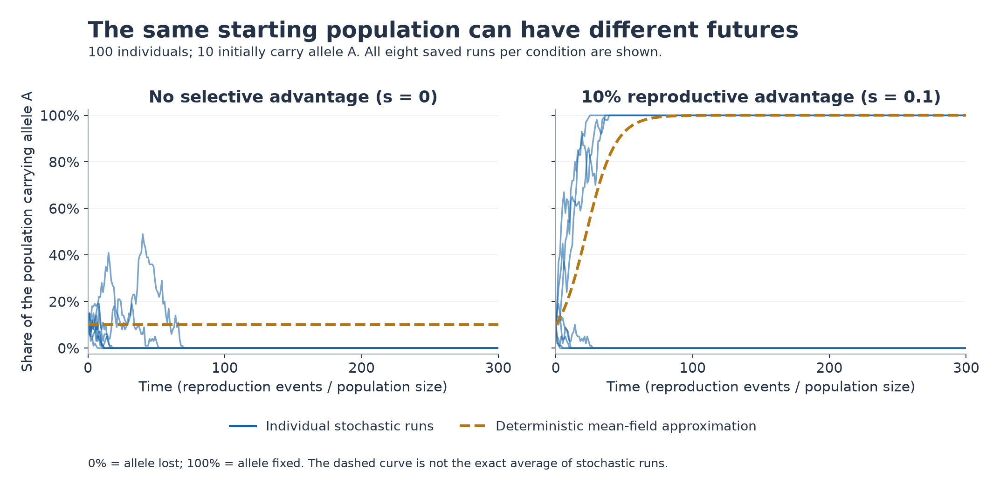
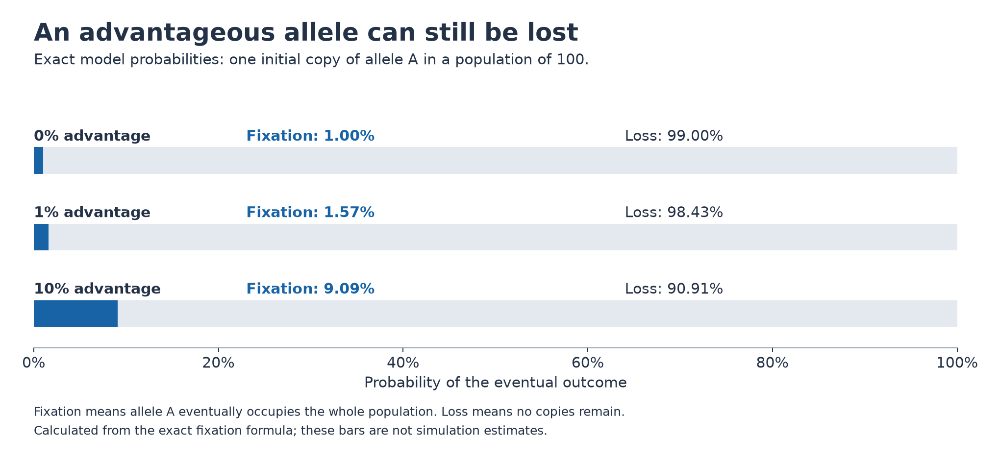
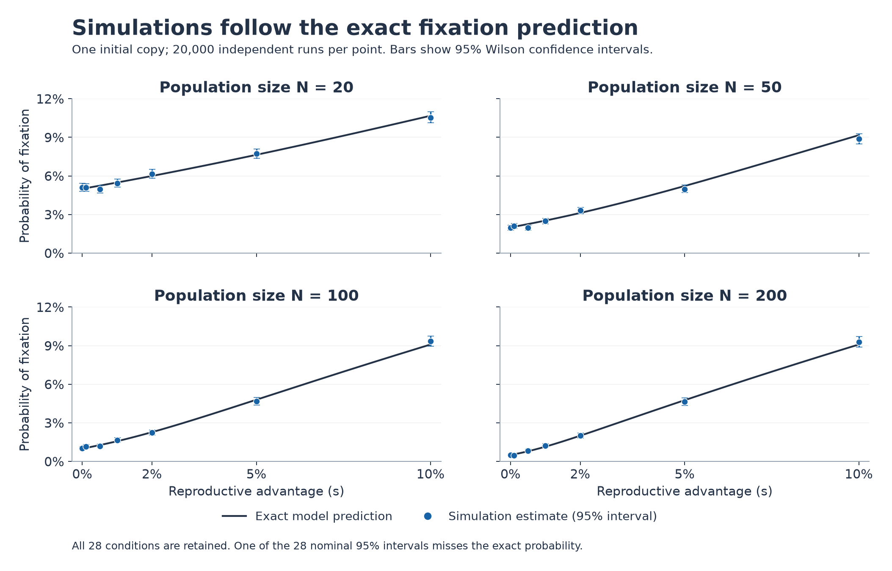

# Selection and genetic drift in the Moran model

A reproducible Julia investigation of when an advantageous allele can still be lost in a finite population. This project studies an established model; it does not claim a new biological discovery.

## Visual results

### Random reproduction gives different outcomes



Every blue line is one of the eight saved runs, starting with 10 copies in a population of 100. Reaching 0% means loss; reaching 100% means fixation. Even with a reproductive advantage, some runs lose the allele. The dashed curve is a mean-field comparison, not the exact average of stochastic runs.

### Advantage does not guarantee survival



Starting from one copy in 100 individuals, a 10% reproductive advantage gives only about a 9.09% chance of eventual fixation. These bars use the exact mathematical formula, so they have no Monte Carlo sampling error. This is a different starting condition from the trajectory figure above.

### Check the simulation against the mathematics



Each point represents 20,000 completed simulations. The curves are exact model predictions; the error bars are 95% Wilson confidence intervals. All 28 conditions are shown, including the one whose interval misses the exact value. Both axes use the same scales across panels.

Figures are drawn from [`results/full/`](results/full/) by [`scripts/plot_results.py`](scripts/plot_results.py). The full teaching guide is not included in this repository.

## Model

The population contains `N` haploid individuals of two genetic types. The advantageous type has relative reproductive fitness `1+s`; the other has fitness `1`. Each event selects a parent proportional to fitness and independently selects an individual for replacement. Population size stays fixed, with no further mutation.

Starting from `i` advantageous individuals, the exact fixation probability is

```text
P_fix(i) = [1 - (1+s)^(-i)] / [1 - (1+s)^(-N)]
P_fix(i) = i/N when s = 0
```

The simulations are checked against this result and an independent numerical solution of the backward recurrence.

## Run

Julia 1.13.1 was used for the recorded results. No external Julia packages are required.

```sh
julia --project=. scripts/demo.jl
julia --project=. test/runtests.jl
julia --project=. scripts/run_study.jl --quick
```

For the full study:

```sh
julia --project=. scripts/run_study.jl
```

The quick run writes to `results/demo/`; the full run writes to `results/full/`. Re-running replaces the corresponding generated files.

## Study and results

The full study uses one initial copy, `N = [20, 50, 100, 200]` and `s = [0, .001, .005, .01, .02, .05, .1]`, with 20,000 repetitions per condition: **560,000 completed experiments**. Every fixation experiment runs until loss or fixation. Seeds and environment details are recorded alongside the data.

For `N = 100` and `s = .01`, the study recorded **332 fixations in 20,000 runs (0.0166)**. The exact probability is **0.01570865656**, and the 95% Wilson interval is **[0.01491983882, 0.01846582164]**. Selection improves on the neutral probability of 0.01, while loss remains overwhelmingly likely.

Across all 28 conditions, 27 nominal 95% intervals contain the exact probability. The remaining interval is retained; simulations were not selected to force complete coverage.

## Files

| Path | Contents |
| --- | --- |
| `src/MoranModel.jl` | Model, exact probabilities and supporting calculations |
| `scripts/demo.jl` | Small worked demonstration |
| `scripts/run_study.jl` | Quick and full simulation studies |
| `test/runtests.jl` | 1,925 checks of probabilities, boundaries, recurrence and simulations |
| `results/full/` | Full-study data, seeds, metadata and log |
| `results/demo/` | Separate quick-run results |
| `results/test_summary.txt` | Recorded test output |
| `Project.toml`, `Manifest.toml` | Julia environment |

`fixation.csv` contains simulation estimates, exact probabilities and Wilson confidence intervals. `events_mean` is the mean time until either loss or fixation, across all repetitions. Displayed trajectories have a separate finite horizon; unfinished trajectories are not classified as losses. The deterministic comparison is a mean-field approximation, not generally the exact average of stochastic histories.

## Limitations and reference

The model assumes a well-mixed population, constant selection, fixed population size and no mutation after initialization. It excludes spatial structure, changing environments and real genetic data.

See [McCandlish, Epstein and Plotkin (2015)](https://arxiv.org/abs/1312.1673). Their log-fitness convention differs from the relative-fitness advantage used here: log-fitness is `log(1+s)`.

## Regenerate the figures

Python is needed only to redraw the PNG figures; the model and simulations run in Julia.

```sh
python3 -m pip install -r requirements-figures.txt
python3 scripts/plot_results.py
```

The plotting script reads the saved full-study CSV files, shows all supplied trajectories and parameter conditions, and writes the three images to `figures/`. It does not rerun or alter the Julia simulations.
